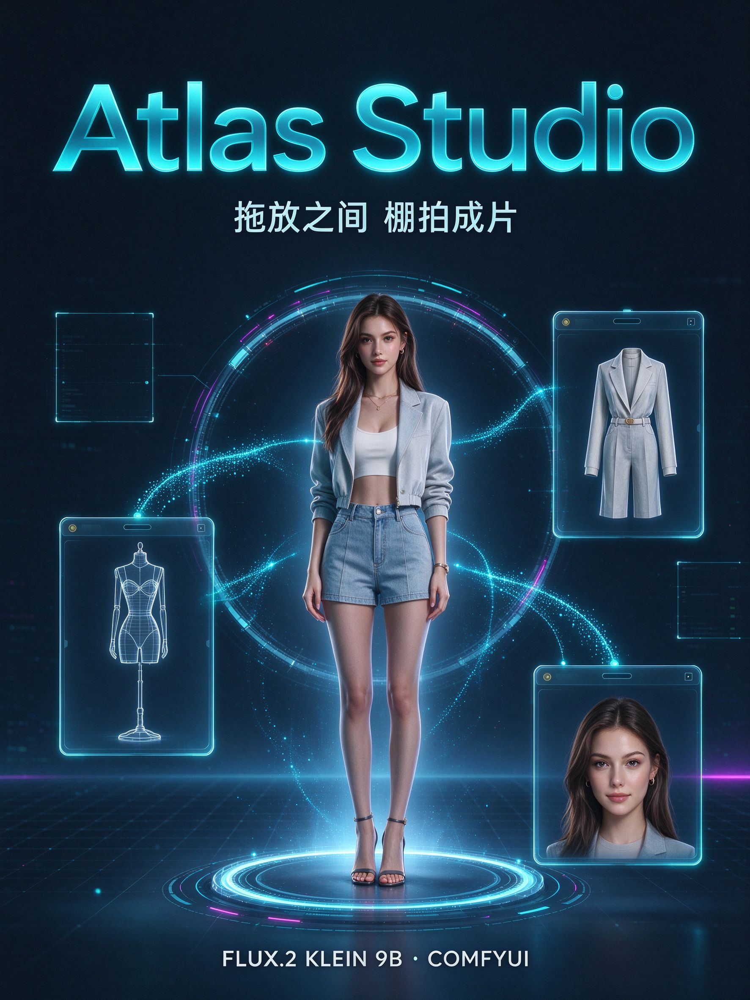
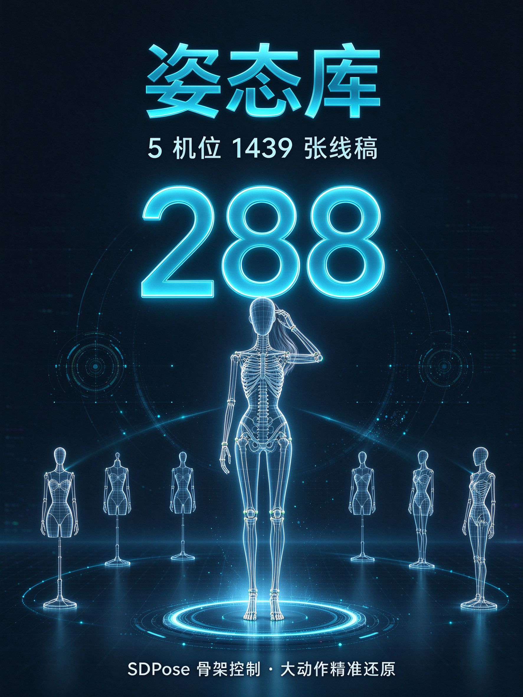
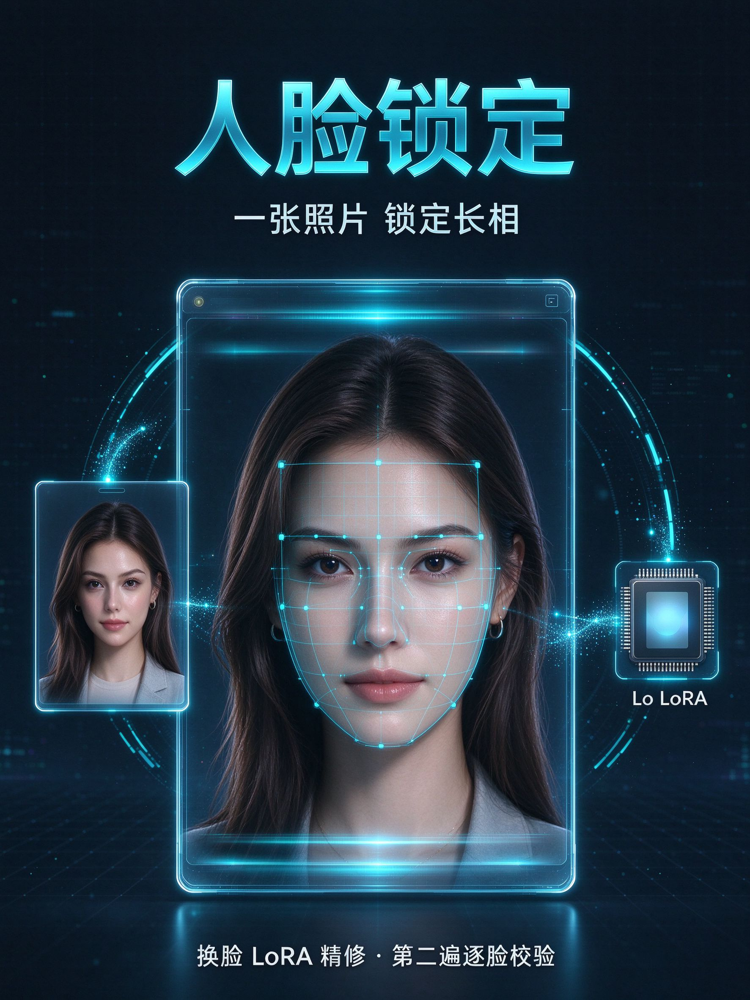
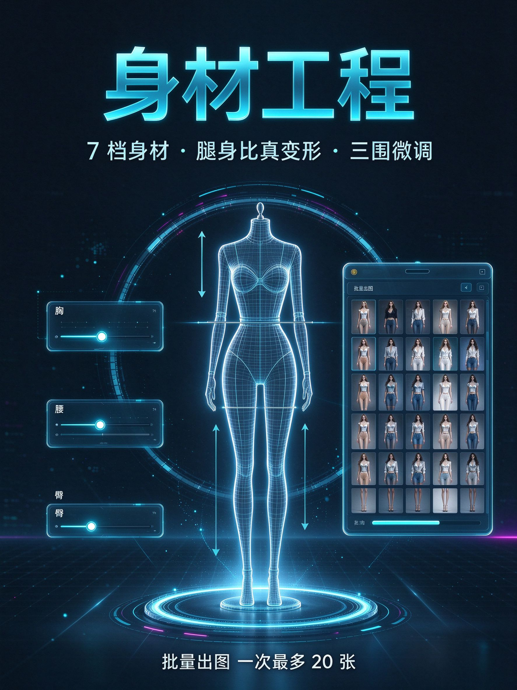

# Atlas Studio · 拖放式 AI 人像生成台

**拖一张姿势、拖一套衣服、选好身材参数，一键出棚拍级人像。**

Atlas Studio 是一个基于 [ComfyUI](https://github.com/comfyanonymous/ComfyUI) 与 **FLUX.2 Klein 9B** 模型的本地人像生成工作台：左侧三个投放位、右侧两大素材库，不需要写提示词、不需要懂节点，普通用户通过拖拽即可完成「姿态还原 + 服装替换 + 人脸锁定」的整套棚拍流程。



---

## 一、功能海报总览

| 姿态库 | 衣装库 |
|:---:|:---:|
|  |  |
| 288 组姿态 × 5 机位，SDPose 骨架精准控制 | 1407 套造型，整身服装一键换装 |

| 人脸锁定 | 身材工程 |
|:---:|:---:|
|  |  |
| 一张真人照锁定长相，换脸 LoRA 精修 | 7 档身材、腿身比真变形、三围微调 |

---

## 二、核心功能详解

### 1. 三个投放位：拖拽即完成配置

界面左侧自上而下三个投放位，从右侧素材库拖入或点击本地选图：

| 投放位 | 接受内容 | 作用 |
|---|---|---|
| **01 · 姿势** | 姿态库线稿人台，或自有姿势图 | 只取姿势与机位，不取人台的胖瘦和画风 |
| **02 · 服装** | 衣装库整套造型，或自有服装图 | 取整身服装 + 鞋包配饰 + 袜子 |
| **03 · 人脸**（可选） | 一张真人照片 | 锁定长相；不放置容易生成白模人台，强烈建议提供 |

放好姿势后，槽位会出现**机位按钮**（正面 / 俯视 / 仰视 / 侧面 / 斜侧），点一下立刻切换同一姿态的不同机位，无需重新找图。

### 2. 姿态库：288 组姿态，1439 张线稿

- 内置 **288 组姿态**，每组含 **5 个机位**，共 **1439 张**线稿人台（800×1200）。
- 覆盖站姿、坐姿、跪立、趴卧、双人缠绵、全身/半身、性感系/标准系等分类标签。
- 支持中文姿势名、编号（如 `P019`）搜索；点卡片可开大图、切机位并直接用作参考。

### 3. 四档姿态控制：从「最快」到「最准」

| 档位 | 参考图构成 | 适合场景 | 参考耗时 |
|---|---|---|---|
| **骨架（默认）** | SDPose 骨架 + 线稿 + 服装 | 大动作、复杂手脚（抱膝、单腿后抬、抬腿过肩） | 约 57s |
| 线稿 + 深度 | 深度图 + 线稿 + 服装 | 常规站坐姿 | 约 52s |
| 仅深度 | 深度图 + 服装 | 求快、姿势简单 | 约 45s |
| 仅线稿 | 线稿 + 服装 | 最快出图 | 约 40s |

**骨架模式**通过 SDPose 把线稿人台提取成「点 + 棍」关节图（含双手十指、双脚脚趾）再喂给模型，约束比线稿/深度更硬；同一姿势的骨架只计算一次并缓存，重复生成不再多花时间。

### 4. 衣装库：1407 套造型，整身换装

- 内置 **1407 套**服装造型，每套含 `thumbs / img / png` 三档分辨率。
- 一套参考同时包含**整身服装、鞋包配饰、袜子**，换装不是只换上衣，而是整体造型迁移。
- 支持按季节（春 / 夏 / 秋 / 冬 / 水着 / ランジェリー / パーティー等）筛选，支持英文关键词与编号（如 `SPR-0001`）搜索。

### 5. 人脸锁定与换脸精修

- 拖入一张真人照，模型即按照片锁定人物长相；放置照片后，族裔面孔描述自动跳过，完全以照片为准。
- **换脸精修**默认勾选：出图后再跑第二遍，用换脸 LoRA（`klein9b_smart_character_swap`）把面部精确贴合，默认 LoRA 强度 0.95。
- 不提供照片时，可在「中国 / 韩国 / 日本 / 美国 / 混血」五档面孔中选择，默认固定为中国脸，避免模型往欧美脸漂移。
- 状态栏会明确标注「已换脸」或具体失败原因，换脸版本同时保留未换脸的**底图**便于对比。

### 6. 身材工程：改图不改词的硬控制

| 维度 | 可选项 / 范围 | 说明 |
|---|---|---|
| **身材 7 档** | 超瘦纸片人 / 极瘦骨感（默认）/ 纤细网红 / 模特高瘦 / 标准匀称 / 丰满沙漏 / 丰腴偏胖 | 同时把参考图横向压窄，比纯提示词效果强得多 |
| **胖瘦微调** | 滑块 70%–108%，默认 84% | 直接控制参考图横向压缩比，78%–84% 自然度与瘦度最平衡 |
| **身高 4 档** | 娇小 155 / 标准 163（默认）/ 高挑 170 / 超模 178 | 影响整体高挑感与四肢长度 |
| **腿身比 4 档** | 短腿 ×0.90 / 标准 ×1.00 / 长腿 ×1.12 / 超长腿 ×1.24 | 从腰线切开下半身纵向拉伸，实现九头身，是真正的图像变形 |
| **三围滑块** | 胸 / 腰 / 臀，各 0–100 | 注意腰滑块右侧代表更细；配合身材档位效果最佳 |

### 7. 批量出图与其他参数

- **批量模式**：一次最多 **20 张**，适合批量试姿态、批量换装。
- **画幅比例**：2:3（832×1216，默认）/ 3:4 / 9:16 / 1:1 / 864×1536。
- **种子**：同种子同参数可复现结果；「换个种子再来一张」不改配置直接重出。
- **步数**：默认 10，低于 8 容易出现畸形手脚，12 更稳但更慢。
- **描述框**：可补充场景 / 光线 / 氛围，拼在提示词最前面、权重最高。

---

## 三、技术架构

Atlas Studio 的生成链路是「**多图参考 + 指令编辑**」，而非传统 ControlNet：

- **生成引擎**：FLUX.2 Klein 9B（FP8），一次前向同时完成姿势还原、服装替换与人脸参考。
- **核心节点**：`PainterFluxImageEdit` 接受 1–4 张参考图与文字指令，输出 latent 直接进入采样。
- **姿态识别**：ComfyUI-SDPose（WholeBody 全身骨架，含手指脚趾）；传统 DWPose/OpenPose 对线稿人台无效。
- **深度预处理**：Depth Anything V2（`comfyui_controlnet_aux`）。
- **换脸方案**：换脸 LoRA + 本地生成的羽化头部遮罩，不依赖额外人脸检测节点。
- **应用本体**：后端为 Python 标准库 `http.server`（无额外依赖），前端为单文件深色界面，配置全部相对路径，整包可拷贝迁移。

---

## 四、目录结构

```
Atlas-Studio/
├── app/                        应用本体
│   ├── studio_server.py        后端（标准库 http.server）
│   ├── index.html              前端（单文件，深色界面）
│   ├── config.json             相对路径配置，整包可搬
│   └── 启动 Atlas Studio.bat   一键启动
├── data/                       素材库
│   ├── pose-atlas/             姿态库（288 组 × 5 机位，1439 张线稿）
│   └── costume-gallery/        衣装库（1407 套，三档分辨率）
├── docs/
│   ├── images/posters/         功能海报
│   ├── 01-依赖与节点清单.md
│   ├── 02-模型清单.md
│   ├── 03-部署与迁移.md
│   └── 04-功能与参数说明.md
├── skill/
│   └── flux2-klein-portrait/   ComfyUI 节点图脚本库
└── versions/                   历史版本备份（可回滚）
```

---

## 五、快速开始

1. **启动 ComfyUI**：确认 `http://127.0.0.1:8188` 可以打开（节点与模型见 `docs/01`、`docs/02`）。
2. **双击** `app/启动 Atlas Studio.bat`。
3. 浏览器自动打开 `http://127.0.0.1:8125/`。
4. 拖姿势到「01」、拖服装到「02」、（可选）拖真人照到「03」，点「生成」。

> 「Atlas Server」黑窗口不要关闭，关了服务即停止。

### 输出位置

```
app/work/outputs/<日期>/时-分-秒_成品.jpg
```

按日期分文件夹；换脸时额外保存 `_底图.jpg`。中间文件（人脸裁剪、遮罩、深度图、骨架图）存放在 `work/tmp`、`work/depth`、`work/pose`，不会混入输出目录。

---

## 六、性能参考（12GB 显存）

| 场景 | 耗时 |
|---|---|
| 仅线稿，无换脸 | 约 40s |
| 骨架模式，无换脸 | 约 57s |
| 骨架 + 换脸 | 约 80s |
| 新姿势首次（需算骨架 + 深度） | 再加 12–15s |

同一姿势、同一腿身比再次生成时缓存命中，不额外耗时；显存不足时程序自动清理并重试 2 次。

---

## 七、常见问题

| 现象 | 处理 |
|---|---|
| 页面一直「检测中」 | 服务未启动，查看 bat 窗口报错；或端口 8125 被占用 |
| 提示「ComfyUI 未启动」 | 单独启动 ComfyUI，确认 8188 可访问 |
| 生成报 CUDA fault | 12GB 显存吃紧，程序自动清显存重试 2 次；仍失败则关闭其他占显存程序 |
| 换机器跑不起来 | 见 `docs/03`，主要检查 bat 的 Python 路径与 `skill/config.json` 的 ComfyUI 路径 |

---

## License

[MIT](LICENSE)
